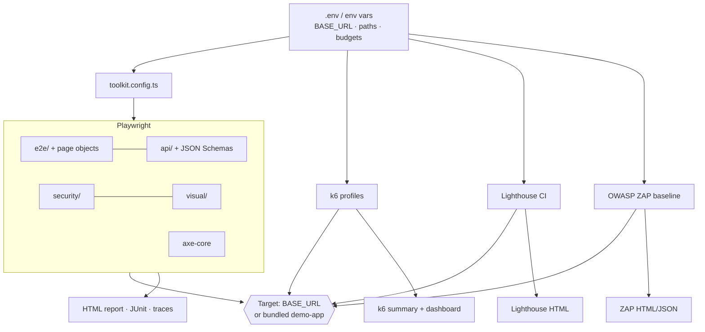
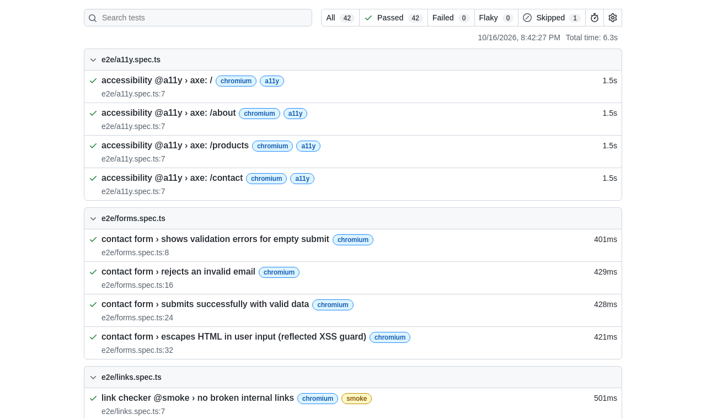

# universal-testing-toolkit

[](https://github.com/HOFFMAN-ALTERNATIVE/universal-testing-toolkit/actions/workflows/ci.yml)


Point it at a URL and get E2E, API contract, accessibility, visual, Lighthouse, load and
security results from one config, each with its own HTML report. 118 Playwright tests
across 5 browser/device profiles, k6 load profiles, Lighthouse budgets and an OWASP ZAP
baseline scan. Every CI run first proves the suite against a bundled demo app, so a red
result on your site is about your site, not about the toolkit.

```bash
BASE_URL=https://staging.example.com npx playwright test
```

## What it checks

| Layer | Tool | What fails the run |
|---|---|---|
| Smoke and links | Playwright | key pages not 2xx/3xx, console errors, missing SEO meta, soft 404s, broken links (BFS crawler) |
| E2E | Playwright, page objects | navigation and forms on Chromium, Firefox, WebKit, Pixel 7, iPhone 14; reflected-XSS guard |
| API | Playwright `request` + Ajv | JSON Schema contract violations, CRUD lifecycle, table-driven negative cases, headers |
| Accessibility | @axe-core/playwright | any WCAG 2.1 AA violation, on every page and browser |
| Visual | Playwright screenshots | pixel diff against baselines recorded in a pinned container |
| Performance and SEO | Lighthouse CI | score budgets plus LCP, CLS, TBT and JS-size budgets, median of 3 runs |
| Load | k6 | SLO thresholds in smoke, load, stress, spike and soak profiles |
| Security | Playwright + OWASP ZAP | missing security headers, TLS and redirect issues, exposed files, path traversal, ZAP baseline alerts |

## Run it

```bash
git clone https://github.com/HOFFMAN-ALTERNATIVE/universal-testing-toolkit.git
cd universal-testing-toolkit
make install                 # npm ci + Playwright browsers

make smoke api security      # against the bundled demo app (started automatically)
make e2e a11y visual
make lighthouse load-smoke

export BASE_URL=https://staging.example.com
make smoke security lighthouse
make load VUS=50 SCALE=0.2
make zap                     # needs Docker
make report                  # open the Playwright HTML report
```

In Docker (runner image plus demo app):

```bash
mkdir -p reports             # the runner writes here as uid 1000
docker compose up --build --abort-on-container-exit
docker run --rm -e BASE_URL=https://staging.example.com -v "$PWD/reports:/suite/reports" \
  ghcr.io/hoffman-alternative/universal-testing-toolkit:latest ci-fast
```

`make help` lists every target. All settings are in [`.env.example`](.env.example).

## How it works



## Measured on the demo app

Local run, 2026-10-17, Chromium:

| Check | Result |
|---|---|
| `api` + `security` projects | 24 passed, 1 skipped (HTTPS redirect, demo runs on plain HTTP), 1.9 s |
| `@smoke` on Chromium | 7 passed, 2.3 s |
| Lighthouse (`/`, `/about`, `/contact`) | 100 in performance, accessibility, best practices and SEO, median of 3 runs |
| `node --test demo-app/` | 4 passed (crash, traversal, body limit and timeout regressions) |

On a real site expect lower Lighthouse numbers; the demo is a few static pages on localhost.

## Design decisions

- [ADR 0001](docs/adr/0001-playwright-as-single-runner.md): Playwright runs E2E, API
  and HTTP security checks. One runner, one report format, one retry and tracing model.
- [ADR 0002](docs/adr/0002-bundled-demo-target.md): a zero-dependency demo app is the
  CI target, so the suite itself is tested on every push.
- [ADR 0003](docs/adr/0003-lighthouse-ci-transitive-advisories.md): keep Lighthouse CI
  despite unpatched transitive advisories, with overrides for the fixable ones.

## Limits

- Visual baselines are only stable inside the pinned Playwright container. Re-record
  them with the `update-visual-baselines` workflow, not on a laptop.
- No authenticated flows out of the box. Add a `storageState` setup project for sites
  behind a login.
- k6 thresholds are tuned for the demo app. Set your own SLOs in `k6/lib` before
  trusting a green load run.
- The ZAP job is a baseline (passive) scan, not a full active pentest.

## Responsible use

Load tests and ZAP scans generate real traffic. Run them only against systems you own
or are authorised to test.

## Security

The runner container runs as an unprivileged user, the demo app is read-only with all
capabilities dropped, and the demo server has request timeouts, body limits and
bounded in-memory storage. See [SECURITY.md](SECURITY.md).

## CI

Every push runs lint, typecheck, demo-app regression tests and `npm audit`, then 7
Playwright projects in parallel, visual, Lighthouse, k6 (smoke, scaled load, spike),
ZAP and the Docker end-to-end run. Each job uploads its report. A weekly scheduled run
catches browser and dependency drift.



## Documentation

1. [Overview](docs/01-overview.md) · 2. [Adapting to your site](docs/02-adapting.md) ·
3. [E2E](docs/03-e2e.md) · 4. [API](docs/04-api.md) · 5. [Accessibility](docs/05-accessibility.md) ·
6. [Visual](docs/06-visual.md) · 7. [Lighthouse](docs/07-lighthouse.md) · 8. [Load](docs/08-load.md) ·
9. [Security](docs/09-security.md) · 10. [Reports and CI](docs/10-reports-ci.md)

## Project layout

```
demo-app/      zero-dependency Node target app, Dockerfile, regression tests
tests/         e2e/ (page objects), api/, security/, visual/, support/
schemas/       JSON Schemas for API contracts
k6/            smoke, load, stress, spike, soak + lib/
docs/          guides per test layer, ADRs
scripts/       OWASP ZAP wrapper
```

## Container images

Multi-arch (amd64/arm64) images are published to GHCR on every release:

```bash
docker pull ghcr.io/hoffman-alternative/universal-testing-toolkit:latest
docker pull ghcr.io/hoffman-alternative/universal-testing-toolkit-demo-app:latest
```

## License

MIT, see [LICENSE](LICENSE).
