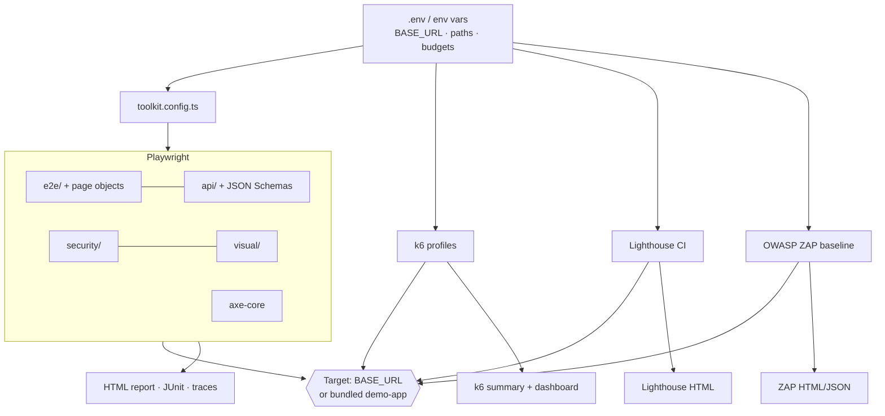
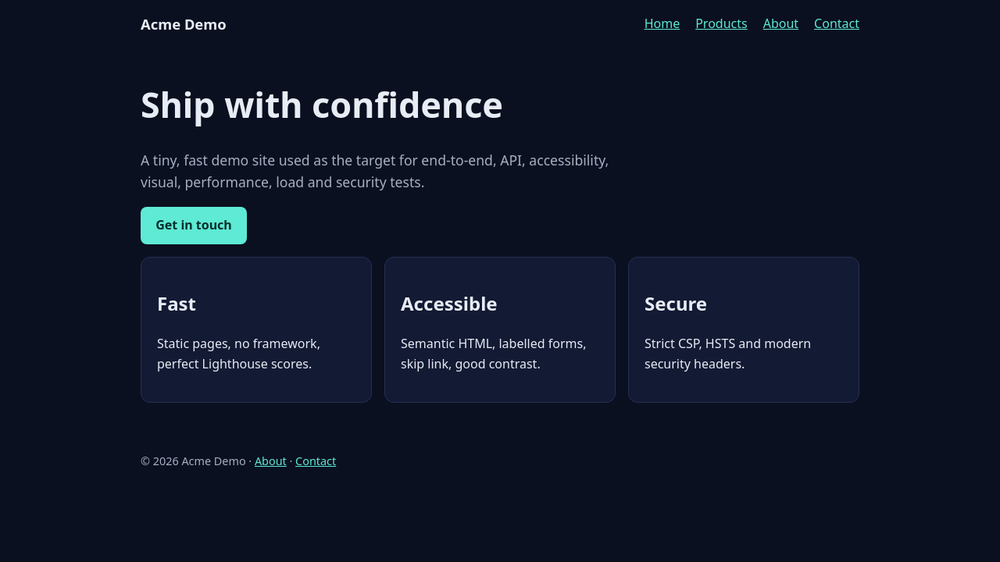

# universal-testing-toolkit

[](https://github.com/HOFFMAN-ALTERNATIVE/universal-testing-toolkit/actions/workflows/ci.yml)


**A point-and-shoot quality suite for any website or web app.** Set `BASE_URL`, run one command, get
E2E, API, accessibility, visual, performance, load and security results — with HTML reports for each.

```bash
BASE_URL=https://staging.example.com npx playwright test
```

## Why

Most projects test one layer (usually unit tests) and discover the rest in production: broken links on mobile Safari,
a missing CSP header, a 4 s LCP, a form that falls over at 50 concurrent users.
This toolkit bundles the **industry-standard tool for each layer**, wires them to a single config, and proves itself
against an included demo app so every CI run is green by construction — any red you see on *your* site is real.

## What's inside

| Layer | Tool | Highlights |
|---|---|---|
| 🔥 Smoke & links | Playwright | every key page < 400, no console errors, SEO meta, real 404s, BFS link crawler |
| 🧭 E2E | Playwright + Page Objects | Chromium, Firefox, WebKit, Pixel 7, iPhone 14 · navigation, forms, XSS guard |
| 🔌 API | Playwright `request` + Ajv | JSON-Schema contracts, CRUD lifecycle, table-driven negative tests, header checks |
| ♿ Accessibility | @axe-core/playwright | WCAG 2.1 AA on every page in every browser, full JSON attached to report |
| 🖼 Visual regression | Playwright screenshots | baselines recorded & compared in a pinned container (no font drift) |
| ⚡ Performance & SEO | Lighthouse CI | score budgets + LCP / CLS / TBT / JS-size budgets, 3-run median |
| 📈 Load | k6 | smoke · load · stress · spike · soak, SLO thresholds, HTML dashboards |
| 🛡 Security | Playwright + OWASP ZAP | security headers, TLS & redirect, exposed files, path traversal, ZAP baseline scan |

## Quick start

```bash
git clone https://github.com/HOFFMAN-ALTERNATIVE/universal-testing-toolkit.git
cd universal-testing-toolkit
make install                 # npm ci + Playwright browsers

make smoke api security      # against the bundled demo app (auto-started)
make e2e a11y visual         # browsers & devices
make lighthouse load-smoke   # performance + k6 smoke

export BASE_URL=https://staging.example.com   # now aim at your site
make smoke security lighthouse
make load VUS=50 SCALE=0.2
make zap                                      # needs Docker
make report                                   # open the Playwright HTML report
```

Everything in Docker (runner image + demo app):

```bash
docker compose up --build --abort-on-container-exit
docker build -t utt . && docker run --rm -e BASE_URL=https://staging.example.com -v "$PWD/reports:/suite/reports" utt ci-fast
```

Run `make help` for every target. All knobs are listed in [`.env.example`](.env.example).

## Architecture



## Reports


<details><summary>Demo target app</summary>


</details>

## CI

Every push runs **lint → 7 Playwright projects in parallel → visual → Lighthouse → k6 (smoke, scaled load, spike) → ZAP → Docker end-to-end**,
and uploads every report as an artifact. A weekly scheduled run catches browser and dependency drift.
Visual baselines are re-recorded by the manual **update-visual-baselines** workflow.

## Documentation

Full breakdown of every test type, how to adapt it and how to read its report: **[docs/](docs/README.md)**

1. [Overview & architecture](docs/01-overview.md) · 2. [Adapting to your site](docs/02-adapting.md) · 3. [E2E](docs/03-e2e.md) ·
4. [API](docs/04-api.md) · 5. [Accessibility](docs/05-accessibility.md) · 6. [Visual](docs/06-visual.md) ·
7. [Lighthouse](docs/07-lighthouse.md) · 8. [Load (k6)](docs/08-load.md) · 9. [Security](docs/09-security.md) · 10. [Reports & CI](docs/10-reports-ci.md)

## Project layout

```
demo-app/      zero-dependency Node target app (+ Dockerfile)
tests/         e2e/ (pages/), api/, security/, visual/, support/
schemas/       JSON Schemas for API contracts
k6/            smoke · load · stress · spike · soak + lib/
docs/          guides for every test layer
scripts/       OWASP ZAP wrapper
```

## Responsible use

Load tests and ZAP scans generate real traffic. Only run them against systems you own or are authorised to test.

## License

MIT — see [LICENSE](LICENSE).
