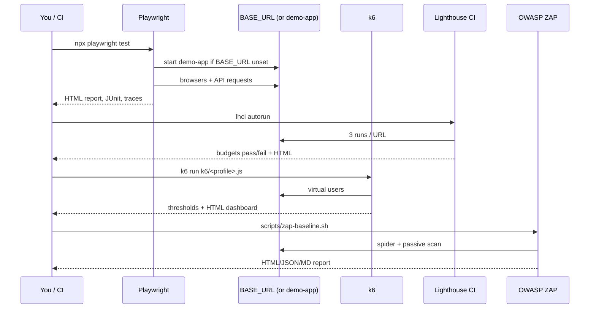

# 01 — Overview & architecture

The toolkit answers one question for any website or web app: **"Is it working, usable, fast, resilient and safely configured?"**
It does so with seven complementary test layers, each using the industry-standard tool for the job.

| Layer | Tool | Answers | Typical runtime |
|---|---|---|---|
| Smoke + links | Playwright | Do key pages load without errors? Any broken links? | seconds |
| E2E | Playwright (5 browser/device projects) | Do real user journeys work in every browser? | 1–3 min |
| API | Playwright `request` + Ajv | Does the API honour its contract, including error cases? | seconds |
| Accessibility | axe-core | WCAG 2.1 AA violations? | seconds |
| Visual | Playwright screenshots | Did anything change visually that shouldn't have? | seconds |
| Performance | Lighthouse CI | Are Core Web Vitals and SEO within budget? | 1–2 min |
| Load | k6 | How does it behave under expected, extreme, bursty and sustained load? | minutes–hours |
| Security | Playwright + OWASP ZAP | Are security headers, TLS and exposure sane? | 1–3 min |

## Run flow



## Repository layout

```
demo-app/            zero-dependency Node app used as a known-good target
tests/e2e/           browser tests + page objects (pages/)
tests/api/           REST API tests
tests/security/      header / TLS / exposure checks
tests/visual/        screenshot tests + baselines (__screenshots__/)
tests/support/       shared helpers (JSON-schema validation)
schemas/             JSON Schemas describing API responses
k6/                  load profiles + shared lib (config, journey, summary)
lighthouserc.cjs     Lighthouse CI budgets
toolkit.config.ts    target-specific knobs (all env-overridable)
scripts/             ZAP wrapper
Dockerfile, compose  all-in-one runner image
```

## Design principles

- **Target-agnostic.** Everything reads `BASE_URL`; site specifics live in `toolkit.config.ts` / env vars.
- **Known-good reference.** The demo app passes everything, so a failure against *your* site is a real signal, not toolkit noise.
- **One tool per job.** No home-grown load generator or a11y engine.
- **Reports first.** Every layer produces a human-readable HTML report and a machine-readable artefact.
