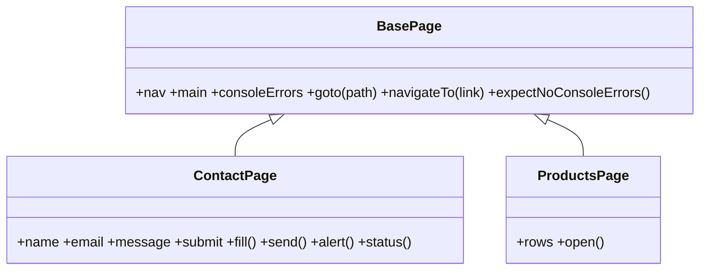

# 03 — E2E & smoke testing

## Projects (browsers & devices)

| Project | Engine | Viewport |
|---|---|---|
| `chromium` | Chromium | Desktop 1280×720 |
| `firefox` | Gecko | Desktop |
| `webkit` | WebKit (Safari) | Desktop |
| `mobile-chrome` | Chromium | Pixel 7, touch, mobile UA |
| `mobile-safari` | WebKit | iPhone 14, touch, mobile UA |

Run one: `npx playwright test --project=webkit`. Run all E2E: `npm run test:e2e`.

## What is covered

| Spec | Purpose |
|---|---|
| `smoke.spec.ts` | Every `SMOKE_PATHS` page returns < 400, has a title, a visible `<main>` and **no console errors**; essential SEO meta; real 404s |
| `navigation.spec.ts` | Main menu reaches every section, skip-link focus, API-rendered content appears |
| `forms.spec.ts` | Server-side validation messages, invalid email, happy path, reflected-XSS guard |
| `links.spec.ts` | Breadth-first crawl of internal links (≤ `CRAWL_LIMIT`), optional external link HEAD checks |
| `a11y.spec.ts` | axe-core scan (see [05](05-accessibility.md)) |

Tag filters: `--grep @smoke`, `--grep @a11y`.

## Page Object Model

`BasePage` collects console errors and uncaught exceptions automatically — any test can assert a clean console.
`navigateTo` opens a hamburger menu first if one is visible, so the same test works on mobile layouts.

## Debugging failures

- `npx playwright test --ui` — time-travel UI
- `npx playwright show-trace reports/test-results/<test>/trace.zip` — trace of a failed CI run (download the artifact)
- Retries are 2 on CI; a test that passes on retry is marked **flaky** in the report — fix it, don't ignore it.
