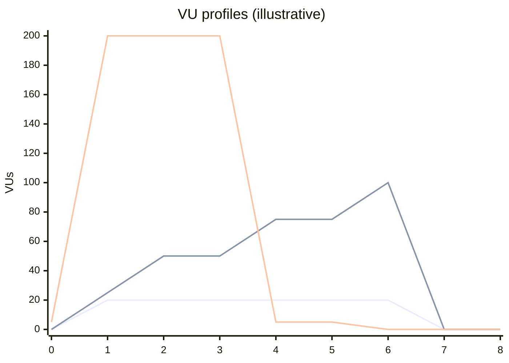

# 08 — Load testing (k6)

All profiles share one realistic **user journey** (`k6/lib/scenario.js`): browse `PAGES`, call the API, think 0.5–2 s.
Requests are tagged `type:page` / `type:api` so thresholds can be set per type.

| Profile | Shape | Question it answers |
|---|---|---|
| `smoke.js` | 1 VU × 5 iterations | Does the script work and the system respond at all? |
| `load.js` | ramp → hold `VUS` 5 min → ramp down | Do we meet SLOs at expected traffic? |
| `stress.js` | 25 → 50 → 75 → 100% of `VUS` in steps | Where does it break, and how? |
| `spike.js` | 5 → `VUS` in 10 s, hold, drop | Does it survive a sudden burst and recover? |
| `soak.js` | moderate load for hours | Memory leaks, connection-pool exhaustion, disk/log growth |



## Thresholds = automated SLOs

```js
http_req_failed: ["rate<0.01"],                 // < 1% errors
http_req_duration: ["p(95)<500", "p(99)<1500"], // latency percentiles
"http_req_duration{type:api}": ["p(95)<300"],
checks: ["rate>0.99"],
```

k6 exits non-zero when a threshold fails, so CI fails.

## Running

```bash
make load-smoke
make load VUS=50
make spike SCALE=0.2          # 5x shorter
BASE_URL=https://staging.example.com make stress VUS=300
```

`SCALE` multiplies every stage duration — CI uses `SCALE=0.1`.

## Reading results

- Console summary + `reports/k6/<profile>.json`
- `K6_WEB_DASHBOARD_EXPORT` HTML dashboard (`reports/k6/<profile>.html`) with time-series of VUs, RPS, latency percentiles and errors.

Look for: latency knee (where p95 starts climbing faster than VUs), first errors (and their status codes), and whether
latency returns to baseline after a spike.
