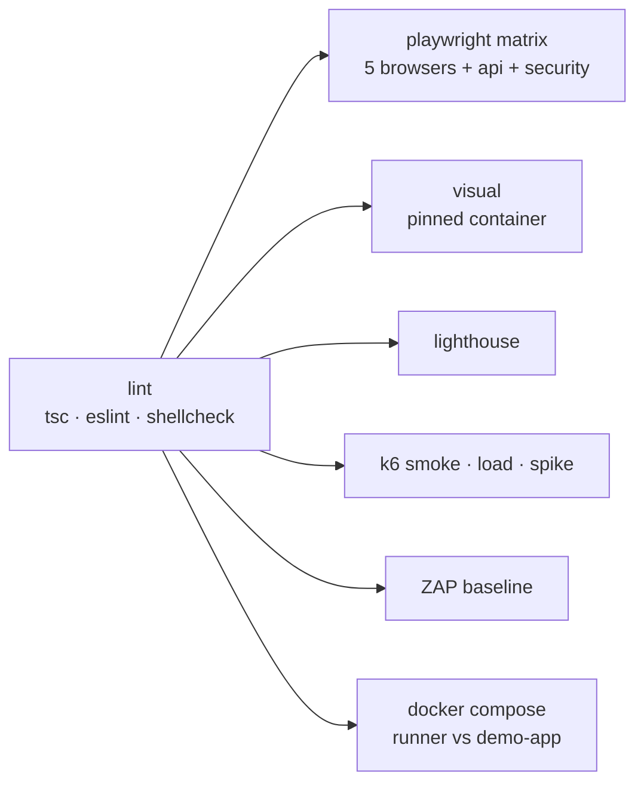

# 10 — Reports & CI

| Layer | Local path | CI artifact |
|---|---|---|
| Playwright (HTML, traces, videos) | `reports/playwright/`, `reports/test-results/` | `playwright-report-<project>` |
| JUnit (for any CI dashboard) | `reports/junit.xml` | in the same artifact |
| Visual diffs | `reports/playwright/` | `visual-report` |
| Lighthouse | `reports/lighthouse/` | `lighthouse-report` |
| k6 | `reports/k6/*.json`, `*.html` | `k6-report` |
| ZAP | `reports/zap/` | `zap-report` |

Open the Playwright report: `npm run report` (or unzip the artifact and run `npx playwright show-report <dir>`).

## Pipeline



The workflow also runs weekly (cron) so drift in browsers or dependencies is caught early.

## Using it against your own site in CI

Set a repository variable/secret `BASE_URL` and add `env: { BASE_URL: ${{ vars.BASE_URL }} }` to the jobs, or run the Docker image:

```bash
docker build -t utt .
docker run --rm -e BASE_URL=https://staging.example.com -v "$PWD/reports:/suite/reports" utt ci-fast
```
